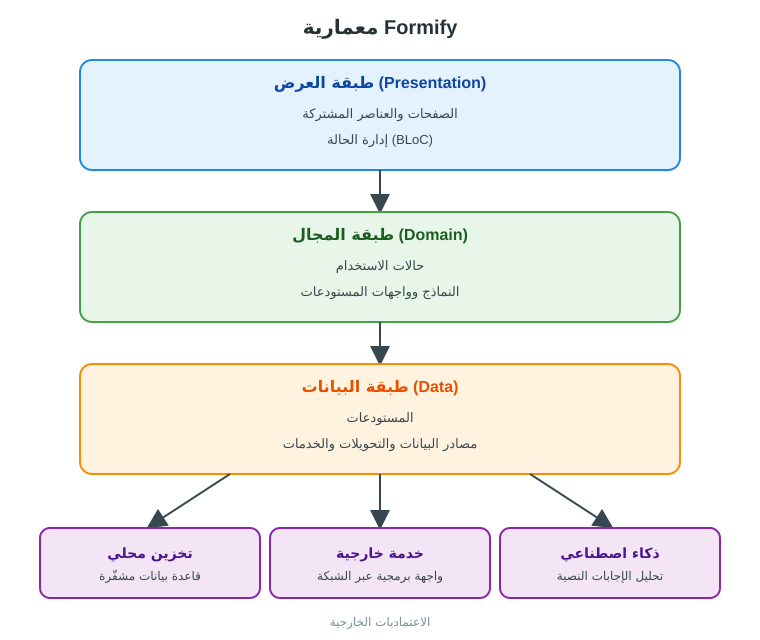

# 📋 Formify

**Formify** تطبيق Flutter لإدارة المؤتمرات وبناء الاستبيانات الديناميكية وجمع الإجابات وتحليلها، مع نموذج ويب عام لتعبئة الاستبيان.


## ✨ ماذا يفعل؟

| الدور | الوظائف |
|---|---|
| **مستخدم التطبيق (المنظّم)** | إنشاء المؤتمرات والاستبيانات وربطها ببعضها، إدارة الاختصاصات والمشاركين، تسجيل الحضور وتعبئة الاستبيانات، عرض الإحصاءات، تصدير النتائج إلى Excel، تحليل الإجابات النصية بالذكاء الاصطناعي |
| **المُجيب عبر الويب** | فتح نموذج الاستبيان العام من المتصفح وتعبئته وإرساله |

## 🌟 أبرز النقاط

- استبيانات **ديناميكية** بأنواع أسئلة متعددة: نص، رقم، تاريخ ووقت، قوائم منسدلة، اختيار واحد أو متعدد، إكمال تلقائي، مفتاح تبديل، شريط تمرير، تقييم.
- إدارة **المؤتمرات** وربطها بالاستبيانات والاختصاصات.
- **لوحة إحصاءات** برسوم بيانية للإجابات.
- **تحليل بالذكاء الاصطناعي** (Gemini) لملخّص الإجابات النصية.
- **تصدير إلى Excel** ومشاركة الملف.
- واجهة **عربية** (RTL) بخطوط عربية ومتعددة المنصات.

## 🏗️ المعمارية



تنتقل البيانات من الواجهة عبر BLoC إلى حالات الاستخدام (Use Cases)، ثم إلى المستودعات التي تتعامل مع التخزين المحلي والخدمات الخارجية.
وتعود النتائج عبر الطبقات نفسها إلى الواجهة على شكل حالات (States) تُعرض للمستخدم.

## 🧰 التقنيات

| الفئة | الأدوات |
|---|---|
| الإطار واللغة | Flutter، Dart |
| إدارة الحالة | bloc، flutter_bloc |
| حقن الاعتماديات | get_it |
| الشبكة | dio، retrofit |
| التخزين المحلي | SQLite (sqflite_sqlcipher)، flutter_secure_storage |
| النماذج | flutter_form_builder، form_builder_validators |
| الرسوم البيانية | fl_chart، syncfusion_flutter_charts |
| الذكاء الاصطناعي | google_generative_ai |
| التقارير والمشاركة | excel، share_plus |
| الواجهة والتعريب | easy_localization، flutter_screenutil، responsive_framework، lottie |

## 🚀 التشغيل

```bash
flutter pub get
flutter run
```

> يتطلب Flutter SDK يدعم Dart 3.9.2 أو أحدث، وملف إعدادات `.env` خاصاً بك.

## 🖼️ لقطات الشاشة

> أضف لقطات الشاشة في المجلد `docs/screenshots/` ثم اربطها هنا.
