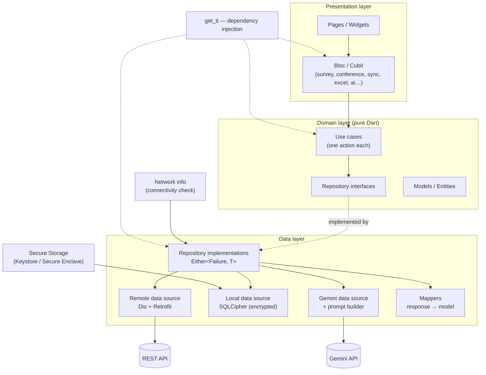
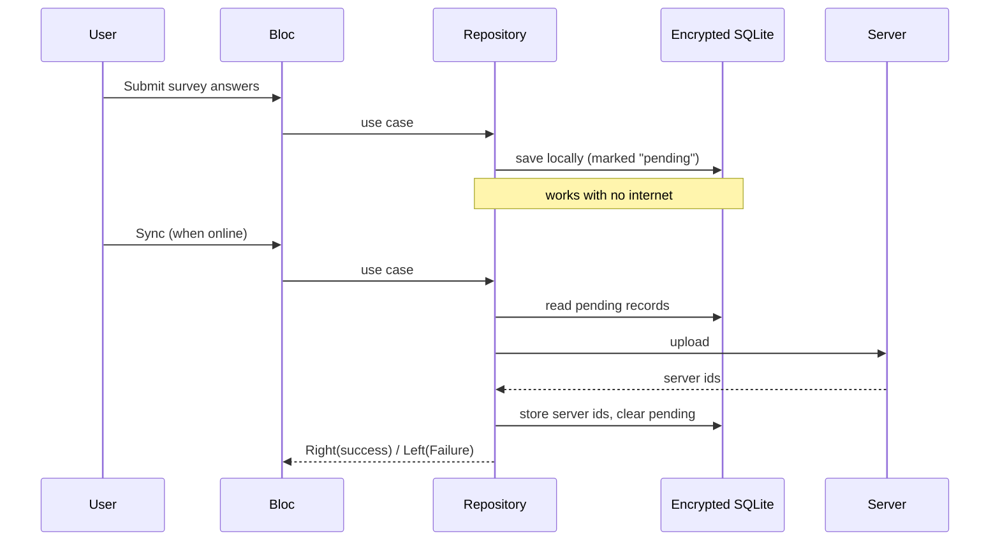

# Formify — Architecture Showcase

> Showcase document for the CV. Contains **no business logic** — architecture only.
> Copy this file into a public repo named `formify-showcase` (README.md) and add screenshots/GIFs.
> If Formify belongs to a company/client: check the contract/NDA first, and use a generic description.

---

## 0) Project overview — شرح المشروع

### بالعربي
**DoForma** تطبيق Flutter لإدارة المؤتمرات الطبية وجمع آراء الأطباء عبر استبيانات، ويعمل **أوفلاين** في الميدان ثم يرفع البيانات للسيرفر عند توفر الإنترنت.

**دورة العمل:**
1. **إنشاء مؤتمر ديناميكي**: الاسم، الوصف، العنوان، تاريخ البدء والانتهاء، والاختصاص الطبي المستهدف.
2. **إنشاء استبيان ديناميكي** (أهم ميزة): المدير يبني الاستبيان بنفسه: عنوان ووصف، لون للتطبيق، ووقت مسموح. ثم يضيف الأسئلة من **16 نوع حقل**: نص، بريد، كلمة مرور، هاتف، رقم، قائمة منسدلة، اختيار واحد، اختيارات متعددة، إكمال تلقائي، تاريخ، وقت، تاريخ ووقت، مفتاح تشغيل، منزلق (slider)، تقييم، وحقل عام. كل سؤال له خيار "إلزامي" ومعاينة مباشرة قبل الإضافة.
3. **عرض المؤتمر/الاستبيان بطريقتين**: بشكل **لعبة** (سؤال بسؤال، مؤقت، شريط تقدم) أو بشكل **استبيان عادي**، وهناك أيضاً "عرض كتسجيل حضور".
4. **العمل أوفلاين**: تُحمَّل بيانات المؤتمر والاستبيانات على الجهاز (قاعدة SQLite مشفّرة)، ويملؤها المشاركون بدون إنترنت، مع تسجيل حضور الأطباء والبحث والفلترة بالاختصاص.
5. **الإعدادات والإدارة**: إضافة طبيب مهم، حفظ بيانات المؤتمر (تحميل للجهاز)، رفع البيانات للسيرفر، وإحصائيات المؤتمر (عدد المسجلين والاستبيانات والإجابات)، وقائمة الحضور والردود، وإدارة مستخدمي النظام.
6. **الرفع للأونلاين**: عند توفر الإنترنت تُزامَن الإجابات والحضور مع السيرفر وتظهر في النظام.
7. **الإحصائيات والتحليل**: عرض إحصائيات ورسوم بيانية (fl_chart / Syncfusion)، وتصدير **Excel**، و**تحليل الإجابات النصية بالذكاء الاصطناعي (Google Gemini)**: التطبيق يبني prompt من السؤال والإجابات فيرجع ملخص واتجاه عام (إيجابي/سلبي) وكلمات مفتاحية وتوصيات.

**التقنيات:** Flutter/Dart، Bloc/Cubit، get_it، Dio + Retrofit، SQLCipher + flutter_secure_storage، dartz، json_serializable/freezed، Gemini (`google_generative_ai`)، easy_localization (RTL)، Firebase Crashlytics.

### In English (portfolio blurb)
DoForma is an offline-first Flutter app for running medical conferences and collecting feedback through **dynamically built surveys**. An admin creates a conference, then designs a survey from 16 field types (text, dropdown, multiple choice, slider, rating, date/time…) with live preview. The survey can be presented in a **gamified step-by-step mode** or as a classic form. Everything runs **offline** against an encrypted local database; attendees are checked in and answers are collected in the field, then **synced to the server** when a connection is available. Admins get statistics, charts and Excel export, plus **AI-powered analysis of free-text answers with Google Gemini** (summary, sentiment, keywords, recommendations).

---

## 1) CV entry (copy into "Projects")

**DoForma — Offline-first survey & conference management app for a pharmaceutical company (Flutter)**

- Built a mobile app (Arabic/RTL) to run medical conferences in the field: **dynamic conference creation**, **dynamic survey builder** (questions with multiple-choice answers and live preview), **attendee check-in** with search and filters by medical specialty, and user management for 700+ registered participants
- Designed a layered **Clean Architecture** (data / domain / presentation) with **Bloc/Cubit** for state management and **get_it** for dependency injection
- Built an **offline-first** workflow: encrypted local storage (**SQLCipher**, key kept in the platform Keystore/Secure Enclave) with a sync engine that uploads pending records when connectivity returns
- Implemented a type-safe REST layer with **Dio + Retrofit**, functional error handling (`Either<Failure, T>` via **dartz**) and **40+ single-responsibility use cases**
- Integrated **Google Gemini** for AI-generated descriptions, and **Excel export** + **charts** (fl_chart / Syncfusion) for survey statistics
- Added localization (**easy_localization**), responsive UI, theming, onboarding, and **Firebase Crashlytics** monitoring
- **Stack:** Flutter, Dart, Bloc, get_it, Dio, Retrofit, SQLCipher, dartz, freezed, Gemini API, Firebase Crashlytics
- 🔗 Architecture case study · Demo video · [add links]

Short version (1–2 lines):
> *Formify — Offline-first Flutter app for surveys and conference management. Clean Architecture, Bloc, encrypted SQLite sync, Gemini AI integration.*

---

## 2) Architecture diagram (Mermaid — renders on GitHub)



### Offline sync flow



---

## 3) Folder structure

```
lib/
├── app/                 # DI (get_it), preferences, constants, extensions, app root
├── data/
│   ├── data_source/     # remote (REST) + Gemini data sources
│   ├── network/         # Dio factory, Retrofit API, SQLite factory, error handler, Failure
│   ├── repository/      # repository implementations
│   ├── mapper/          # response → domain model
│   ├── responses/       # json_serializable response models
│   └── services/        # Gemini prompt builder
├── domain/
│   ├── models/
│   ├── repostitory/     # abstract repositories
│   └── usecase/         # single-responsibility use cases
└── presentation/
    ├── survey/ conference/ active_conference/ question/
    ├── sync/ offline_sync/ excel/ ai_desc/ manager_user/ spec_manager/
    │   └── bloc/ page/ widget/
    ├── onboarding/ home/
    └── resources/       # theme bloc, responsive helpers
```

---

## 4) Key decisions (good interview answers)

| Decision | Why |
|---|---|
| Clean Architecture, 3 layers | Business rules independent of Flutter/Dio/SQLite; easy to test and swap data sources |
| Use case per action | Small, testable units; Blocs stay thin |
| `Either<Failure, T>` (dartz) | Errors are explicit values, no scattered try/catch in the UI |
| Offline-first + SQLCipher | Field users (e.g. at conferences) often have poor connectivity; data may be sensitive → encrypted at rest, key in Keystore |
| Retrofit + json_serializable | Generated, type-safe API client; less boilerplate |
| get_it for DI | Layers receive dependencies, no hard-coded construction |

> Fill in 2–3 real **problems & solutions** you faced (e.g. sync conflicts, mapping server ids to local rows) — interviewers love these.

---

## 5) Screens (what the screenshots show)

Home dashboard (create dynamic conference / survey, view conferences / surveys, user management) · dynamic question builder with preview · conference details (location, dates, specialty) · available surveys · attendance check-in with search + present/absent filters.

> ⚠️ Use only sanitized screenshots (no client name/logo, drug names, or real attendee data). Get the client's OK before publishing, and use a generic description ("enterprise app for a pharmaceutical company").

---

## 6) Sharing safely

- Don't publish the real repo, API URLs, `.env`, keys, or screenshots with real data
- Best: tiny public demo app with the same architecture + mock data, plus a 2–3 min demo video
- In interviews: share your screen and walk through the code
- Release builds don't contain source; add `--obfuscate --split-debug-info=<dir>` if you give out an APK
